# Halo: CE Online Co-op Execution Flow & RE Findings

This document records the reverse-engineered execution flow of `halo1.dll` (`ImageBase = 0x180000000`), `initial_ps.s3dpak`, and `MCC-Win64-Shipping.exe` for enabling **4-player online co-op campaign**, the root causes behind earlier 3-player test failures, and the complete hook/patch architecture implemented in [h1_engine_hooks.cpp](file:///home/croc/code/combatevolved-4player/src/hooks/h1_engine_hooks.cpp).

---

## 1. End-to-End 4-Player Launch & Lockstep Architecture

```mermaid
flowchart TD
    A["MCC Lobby (MCC-Win64-Shipping.exe)"] --> B["CreateGameEngine() @ 0x180095A70<br/>IGameEngine vtable @ 0x1817F1578"]
    B --> C["IGameEngine::Start() @ 0x1800939D0<br/>[+0x0C]=launch_mode (1=offline, 3=online), [+0xE8]=launch_players"]
    C --> D["mscript VM -> MatchMake_campaign_net @ 0x180065F70"]

    D --> E["Peer Wait Loop @ 0x1800664BC<br/>cmp [rdi+0x128], cap (patched to launch_players on HOST & CLIENTS)<br/>Timeouts @ 0x18006638B & 0x1800665B7 patched 20s -> 60s"]
    E --> F["HasChannelForSlot @ 0x1803F3290<br/>Fixed slot*2 key lookup mismatch against 0x1803F3750"]
    F --> G["MatchMake_campaign::ApplyChangeMode()<br/>Session.PlayersCount @ 0x180064FC0 clamped >2 -> 2"]
    G --> H["LoadLevelCoop(map, diff, isNew, isOnline) @ 0x180067AB0<br/>5th arg isOnline on stack [rsp+0x28] ([rbp+0x310])"]

    H --> H1["InitGameSession(this, map, dir, diff, isNew) @ 0x180066DF0<br/>sets 0x182E3B821 (is_splitscreen=0), 0x181B7B4AC (coop_local_idx)"]
    H1 --> H2["Hook_LoadLevelCoop post-fix:<br/>0x181B7B910 = total_players (2..4) for Blam<br/>0x181B7B4AC = local_slot (0..3) from Transport0"]
    H2 --> H3["ExternalGetLocalPlayersCount @ 0x18006A4E0<br/>returns 1 when 0x182E3B821==0 so mscript skips splitscreen"]

    H3 --> I["Blam Engine 4-Player Core<br/>players_create_for_new_game @ 0x180AC3484 (0..[0x181B7B910]-1)<br/>input_update_players_4p @ 0x180A997B8 -> staging 0x182C983D4 (4*0x30)"]
    I --> J["Hooked 4-Player Lockstep Multiplexer<br/>Client: SerializeClientInputVTable @ 0x180057A10 appends local_idx (1..3)<br/>Host: OnPacket @ 0x1800554B0 per-client [1..3] state & min_ack pruning<br/>Host: SerializeLockstepVTable @ 0x180057E00 appends P2+P3 actions<br/>Host->Clients: SendPacket @ 0x1801CFE60 broadcasts to remote_slot_mask"]
```

---

## 2. Decompressed `initial_ps.s3dpak` Mscript Logic

Decompressing `initial_ps.s3dpak` (71 zlib chunks, `9,175,040` bytes) confirmed how Saber3D's mscript layer drives campaign co-op launch:

1. **`MatchMake_campaign::ApplyChangeMode()`:**
   - Queries `$sessionActive.PlayersCount()` (`0x180064FC0`).
   - Sets `sNewMode = "single"` if `count == 1`, `"splitscreen"` if `count == 2`, and `"none"` if `count > 2`.
   - `implStartGame()` only calls `LoadLevelCoop` when `sCurrentMode == "splitscreen"`.
   - **Fix:** `Hook_SessionPlayersCount` (`0x180064FC0`) clamps `count > 2 -> 2` unconditionally so `ApplyChangeMode()` selects `"splitscreen"` and invokes `LoadLevelCoop`.

2. **`singl_game_set::OnLevelLoaded()` (`8618010`):**
   - Checks `if ($haloEngine.ExternalLaunch())` -> queries `local_players := $haloEngine.ExternalGetLocalPlayersCount()`, and if `local_players > 1`, enables splitscreen via `$sslUserInputMng.SetSplitScreenInput(local_players)` and `$sslEngineCtrl.SetSplitScreen(true)`.
   - `ExternalGetLocalPlayersCount` (`0x18006A4E0`) reads `WORD [0x181B7B910]`, which has a dual role: mscript uses it as local splitscreen player count, while Blam uses it as **total co-op player count**.
   - **Fix:** Keep `[0x181B7B910] = total_players` (`2..4`) for Blam, and hook `ExternalGetLocalPlayersCount` (`0x18006A4E0`) to return `1` whenever `[0x182E3B821] == 0` (`is_splitscreen == 0`).

3. **`LoadLevelCoop` Mscript Signature (`.rdata @ 0x1817EEC80`):**
   - Signature: `LoadLevelCoop(map: string, difficulty: int, isNew: bool = false, isOnLine: bool = false)`.

---

## 3. Root Causes Resolved from 3-Player Tests

### Bug A: Both Host and Client Launched Into 2-Player Offline Splitscreen
- **Root Cause:** `LoadLevelCoop` (`0x180067AB0`) takes **5 arguments** `(this_ptr, map_str, difficulty, isNew, isOnline)` with `isOnline` at `[rsp+0x28]` (`[rbp+0x310]` checked at `0x180067D4B`). `InitGameSession` (`0x180066DF0`) also takes **5 arguments** (`isNew` at `[rsp+0x28]`).
- Our previous `FnLoadLevel` / `FnInitGameSession` typedefs had only **4 arguments**, dropping `isOnline` and passing `0` (`false`). `LoadLevelCoop` therefore took the offline splitscreen branch (`0x180067D54`), left `0x181B7B4AC = -1`, left `Session0 = NULL`, and enabled 2-player splitscreen viewports.
- **Additionally:** Our earlier patch forcing `0x180067FD2` (`0x181B7B910`) to `1` prevented Blam's `players_create_for_new_game` (`0x180AC3509`) from spawning remote co-op Spartans because `0x181B7B910` is `total_coop_players_count`.
- **Fix:** Fixed 5-arg signatures, removed the `0x180067FD2` patch, set `[0x181B7B910] = total_players` and `[0x181B7B4AC] = local_slot` (`0..3`) post-`LoadLevelCoop`, and hooked `ExternalGetLocalPlayersCount` (`0x18006A4E0`) to return `1` when not splitscreen.

### Bug B: Client 1 Exited Early (`0.38s`) & Hyper-V Timed Out in `MatchMake_campaign_net`
- **Root Cause 1:** `Hook_MatchMakeCampaignNet` only patched `MatchMakePeerCap` (`0x1800664BC`) on the host (`is_host != 0`), leaving clients comparing `[rdi+0x128] >= 2`. Client 1 (`CrocoKyle210`) exited `MatchMake_campaign_net` as soon as it connected to Host, before Hyper-V finished joining.
- **Root Cause 2:** `MatchMake_campaign_net` has a hardcoded `20,000 ms` (`0x4E20`) timeout at `0x18006638B` and `0x1800665B7`, which expired on host 238 ms before Hyper-V completed its transport handshake (worsened by a 2-second artificial hold in `Hook_HasChannelForSlot`).
- **Fix:** Patch `MatchMakePeerCap` and `TransportAdvertCap` to `g_launch_expected_players` on **both host and clients**, remove the 2-second hold in `Hook_HasChannelForSlot`, and extend both `0x4E20` (`20,000 ms`) timeouts to `0xEA60` (`60,000 ms`).

### Bug C: Vanilla In-Game Co-op Lockstep Hardcoded to 2 Players
1. **`0x181B7B4AC` (`coop_local_player_index`) at `0x180067EC9`:** Used `setne r15b` (`0` on host, `1` on all clients) so clients 2 and 3 both got player index `1`. Fixed in `Hook_LoadLevelCoop` using `Transport0->peers[local_idx].slot_id`.
2. **`Coop_ClientSendLocalInput` target slot (`0x1800566D2`):** Computed `esi = 1 - local_slot`, producing `-1` for slot 2 and `-2` for slot 3 (`0x1801D15B0` out-of-bounds read, `1 << -1` send failure). Patched `8B F5 2B F7` -> `31 F6 90 90` (`xor esi, esi; nop; nop`) so every client targets Host slot `0`.
3. **`Coop_IsHostAndRemoteConnected` (`0x180055E70`) & `SendPacket` (`0x1801CFE60`):** Checked and sent lockstep (`[0x181B7AA68]`) and camera sync (`[0x181B7AA6C]`) packets only to the single slot `[0x181BE96FC]`. Hooked both so host checks all remote client slots `1..3` and broadcasts to their full bitmask.
4. **Wire Message Serialization Vtables (`0x1817EE818` & `0x1817EE900`):**
   - `SendPacket` / packet receive invoke virtual serializer/deserializer slots on the message factory objects `0x181BA3A58` (ClientInput `0x58`) and `0x181BA39B8` (LockstepFrame `0x6C`), rather than standalone `0x180054E70` / `0x180054C20` / `0x180054CB0`:
     - ClientInput Serialize (`0x180057A10`): Hooked to append 3-bit `local_player_index` via `0x180054140(bitstream, tag, 7)`.
     - ClientInput Deserialize (`0x180054FD0`, jumped to from `0x180057A00`): Hooked to read `sender_idx` via `0x180054210(bitstream, &sender_idx, 7)` into unused padding byte `pkt_58[0x3B]`.
     - `CoopLockstep_OnPacketReceived` (`0x1800554B0`): Hooked to multiplex per-client `0x58`-byte packet state (`g_host_client_pkt_state[1..3]`) through `0x181BA3A00`, maintain `g_host_client_raw_input[1..3]`, and defer unacked frame queue pruning to `min(ack_tick)` across all active clients.
     - `coop_host_capture_and_send_actions` (`0x180AB14E0`): Hooked to swizzle Players 2 and 3 into `g_extra_lockstep_ring[tick & 0x1FF]` keyed by `[0x181B7AA70]`.
     - LockstepFrame Serialize (`0x180057E00`) & Deserialize (`0x180057D50`): Hooked to append/read Player 2 and Player 3 `0x30`-byte net actions via `0x180054510` / `0x180054790` into the dynamically growable bitstream (`0x1801503E0`).
     - `coop_apply_host_and_client_actions` (`0x180AB1324`): Hooked to populate Players 2 and 3 (`actions_4p + 0x60/0x90`) and set `valid_mask` bits `2` and `3` on both host and clients.

---

## 4. Complete `halo1.dll` Function & Data Address Table

All addresses below assume `halo1.dll` `ImageBase = 0x180000000` (`RVA = VA - 0x180000000`).

### 4.1 Launch, Session, Transport & Mscript Functions
| Symbol / Role | VA | RVA | Notes |
|---|---|---|---|
| `CreateGameEngine` | `0x180095A70` | `0x095A70` | Exported; returns `IGameEngine*` (`vtable @ 0x1817F1578`) |
| `IGameEngine::Start` | `0x1800939D0` | `0x0939D0` | Reads `+0x0C` launch mode (`1`=offline, `3`=online), `+0xE8` player count |
| `Session.PlayersCount` | `0x180064FC0` | `0x064FC0` | Returns `[rcx+0x128]`; registered at `0x3EC450` / `0x3EDB65` |
| `MatchMake_campaign_net` | `0x180065F70` | `0x065F70` | Mesh formation loop; timeouts at `0x18006638B` & `0x1800665B7` (`0x4E20` = 20s) |
| `MatchMakePeerCap` | `0x1800664BC` | `0x0664BC` | `cmp dword ptr [rdi+0x128], 2; jge 0x1800665ED` |
| `InitGameSession` | `0x180066DF0` | `0x066DF0` | 5 args: `(this, map, dir, diff, isNew)` |
| `LoadLevelSolo` | `0x180066AF0` | `0x066AF0` | 4 args: `(this, map_s, diff, isNew)` |
| `LoadLevelCoop` | `0x180067AB0` | `0x067AB0` | 5 args: `(this, map_s, diff, isNew, isOnline)`; online check at `0x180067D4B` |
| `InitRemoteCoopPlayer` | `0x1800683E0` | `0x0683E0` | Binds local HUD/profile slot `0..3` (`imul rdi, rax, 0x2010`) |
| `ExternalGetLocalPlayersCount` | `0x18006A4E0` | `0x06A4E0` | `movsx eax, word ptr [0x181B7B910]; ret` (only called by mscript wrapper `0x180064CF0`) |
| `TransportSendPacket` | `0x1801CFE60` | `0x1CFE60` | `(transport0, slot_mask, msg_id, pkt_buf, bits, flags, a7)` |
| `TransportIsPeerConnected` | `0x1801D15B0` | `0x1D15B0` | Checks `[transport0 + 0x58 + slot*4]` != `-1` & `(flags >> 1) & 1` |
| `TransportAdvertCap` | `0x1802284BF` | `0x2284BF` | `cmp dword ptr [rdx+0x128], 2; jge +0x0F` |
| `HasChannelForSlot` | `0x1803F3290` | `0x3F3290` | Buggy lookup by `slot` vs `0x1803F3750` insert key `slot * 2` |
| `Session::vtable[0xB0]` | `0x1803F33B0` | `0x3F33B0` | Host peer accept & roster broadcast |
| `Session::vtable[0xB8]` | `0x1803F3750` | `0x3F3750` | Inserts channel into `[session+0x120]` under key `slot * 2` |

### 4.2 Saber3D Co-op Lockstep & Blam 4-Player Simulation Functions
| Symbol / Role | VA | RVA | Notes |
|---|---|---|---|
| `BitstreamWriteRangeInt` | `0x180054140` | `0x054140` | `(stream, val, max_val)`; calls `0x1801503E0` growable writer |
| `BitstreamReadRangeInt` | `0x180054210` | `0x054210` | `(stream, &out_val, max_val)`; calls `0x180150790` reader |
| `SerializeNetAction` | `0x180054510` | `0x054510` | Serializes 1 `0x30`-byte net action struct |
| `DeserializeNetAction` | `0x180054790` | `0x054790` | Deserializes 1 `0x30`-byte net action struct |
| `DeserializeClientInput` | `0x180054FD0` | `0x054FD0` | Called via tail jump from `0x180057A00` (`0x1817EE818` vtable `+0xA0`) |
| `CoopLockstep_OnPacketReceived` | `0x1800554B0` | `0x0554B0` | `0x181BA39D0` `vtable[+0x18]`; handles ClientInput / LockstepFrame / CameraSync |
| `Coop_IsSessionActive` | `0x180055DA0` | `0x055DA0` | Checks `[0x182E3B478] != NULL` (resets state if null) |
| `Coop_IsClient` | `0x180055E30` | `0x055E30` | Checks `Transport0` local peer slot != `0` |
| `Coop_IsHostAndRemoteConnected` | `0x180055E70` | `0x055E70` | Vanilla checks only `[0x181BE96FC]`; hooked for slots `1..3` |
| `Coop_HostSendLockstepFrames` | `0x180055F60` | `0x055F60` | Iterates queue `0x181BA39E8`; `0x18005628C` shifts `1 << [0x181BE96FC]` |
| `Coop_ClientSendLocalInput` | `0x180056420` | `0x056420` | `0x1800566D2` target host slot `1 - edi` patched to `0` (`31 F6 90 90`) |
| `Coop_PerTickUpdate` | `0x180056770` | `0x056770` | Copies `0x181BA3A00 -> 0x182B226F8` (`0x180056B18`), camera sync (`0x180056D87`) |
| `Coop_ClientPopLockstepFrame` | `0x180057100` | `0x057100` | Pops `[0x181BA39D8][0]` (`0x6C` stride) into `0x60`-byte output |
| `Coop_HostPushAndSendLockstepFrame` | `0x1800571E0` | `0x0571E0` | Reads & increments `0x181B7AA70`, pushes onto `0x181BA39E8`, calls `0x180055F60` |
| `SerializeClientInput_VTable` | `0x180057A10` | `0x057A10` | `0x1817EE818` vtable `+0x98`; serializes client `0x58`-byte input packet |
| `DeserializeLockstepFrame_VTable` | `0x180057D50` | `0x057D50` | `0x1817EE900` vtable `+0xA0`; deserializes `0x6C`-byte lockstep frame |
| `SerializeLockstepFrame_VTable` | `0x180057E00` | `0x057E00` | `0x1817EE900` vtable `+0x98`; serializes `0x6C`-byte lockstep frame |
| `BitstreamWriteGrowable` | `0x1801503E0` | `0x1503E0` | Dynamically reallocates packet bitstream buffer as bits are appended |
| `input_update_players_4p` | `0x180A997B8` | `0xA997B8` | Samples 4 local slots (`4 * 0x30`); calls `0x180B7CF44` |
| `coop_apply_host_and_client_actions` | `0x180AB1324` | `0xAB1324` | Vanilla applies P0+P1 (`\|=2` host, `\|=3` client); hooked for P0..P3 |
| `coop_host_capture_and_send_actions` | `0x180AB14E0` | `0xAB14E0` | Swizzles actions & pushes frame; hooked to capture P2+P3 actions |
| `players_create_for_new_game` | `0x180AC3484` | `0xAC3484` | Loops `0 .. [0x181B7B910]-1`; assigns gamepad `0` iff `edi == [0x181B7B4AC]` |
| `game_state_save_header` | `0x180ACD680` | `0xACD680` | Saves `[0x181B7B910]` at `[save+0x124]` (validated at `0x180ACDE39`) |
| `input_submit_coop_4p_staging` | `0x180B7CF44` | `0xB7CF44` | Stores mask at `0x182C983D0` & copies `0xC0` bytes to `0x182C983D4` |
| `simulation_build_player_actions_4p` | `0x180C85DC8` | `0xC85DC8` | Copies active slots `0..3` from `0x182C983D4`, calls `0x180AB1324` & `0x180AB14E0` |

### 4.3 Key Globals (`halo1.dll`)
| Name | VA | RVA | Type / Meaning |
|---|---|---|---|
| `g_msg_id_client_input` | `0x181B7AA54` | `0x1B7AA54` | `int32_t`: Client->Host input message ID |
| `g_msg_id_lockstep_frame` | `0x181B7AA68` | `0x1B7AA68` | `int32_t`: Host->Client lockstep tick frame message ID |
| `g_msg_id_camera_sync` | `0x181B7AA6C` | `0x1B7AA6C` | `int32_t`: Host<->Client position/camera sync message ID |
| `g_next_lockstep_tick` | `0x181B7AA70` | `0x1B7AA70` | `uint32_t`: Next lockstep tick ID (post-incremented) |
| `session_ready_flag` (`sr`) | `0x181B7AA80` | `0x1B7AA80` | `uint32_t`: Gating flag checked by `LoadLevelSolo`/`LoadLevelCoop` |
| `coop_local_player_index` | `0x181B7B4AC` | `0x1B7B4AC` | `int32_t`: `-1` offline, `0` host, `1..3` online clients |
| `total_coop_players_count` | `0x181B7B910` | `0x1B7B910` | `int16_t`: Total co-op players (`2..4`) used by Blam engine |
| `client_lockstep_queue_ptr` | `0x181BA39D8` | `0x1BA39D8` | `uint8_t*`: Client incoming lockstep queue (`0x6C` stride) |
| `client_lockstep_queue_cnt` | `0x181BA39E0` | `0x1BA39E0` | `int32_t`: Number of queued frames on client |
| `host_unacked_queue_ptr` | `0x181BA39E8` | `0x1BA39E8` | `uint8_t*`: Host unacked outgoing frames (`0x6C` stride) |
| `host_remote_client_pkt` | `0x181BA3A00` | `0x1BA3A00` | `uint8_t[0x58]`: Host buffer for last received client input (`+0x30` seq) |
| `remote_client_slot_id` | `0x181BE96FC` | `0x1BE96FC` | `int32_t`: Vanilla single remote slot ID |
| `g_active_session0` | `0x182E3B478` | `0x2E3B478` | `Session0*` (`+0x30`=`Transport0*`, `+0x88`=sender handle, `+0x128`=peer_count) |
| `g_is_splitscreen` | `0x182E3B821` | `0x2E3B821` | `uint8_t`: `1` in offline splitscreen, `0` in solo / online co-op |
| `g_coop_4p_valid_mask` | `0x182C983D0` | `0x2C983D0` | `uint8_t`: Bitmask of active slots in 4P staging buffer |
| `g_coop_4p_staging_buf` | `0x182C983D4` | `0x2C983D4` | `uint8_t[4 * 0x30]`: Blam 4-player action staging buffer |
| `g_session_manager` | `0x182E3CE50` | `0x2E3CE50` | Holds active sessions (`[[0x182E3CE50]+0x10][0] == Session0`) |

---

## 5. Offline Verification Status

- Cross-compiled `version.dll` via `cmake --build build-win64 -j` and verified pattern scanning / config / spawn unit tests via `ctest --test-dir build-tests --output-on-failure`.
- All new byte patterns and instruction patch offsets were verified directly against `halo1.dll` (`count == 1`).
